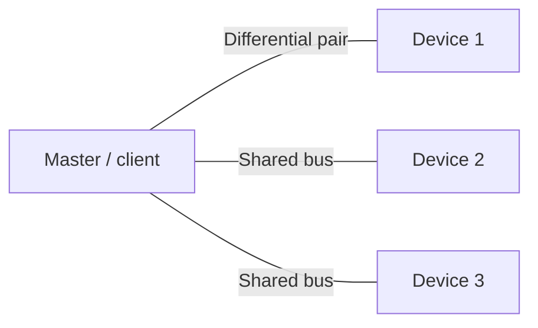
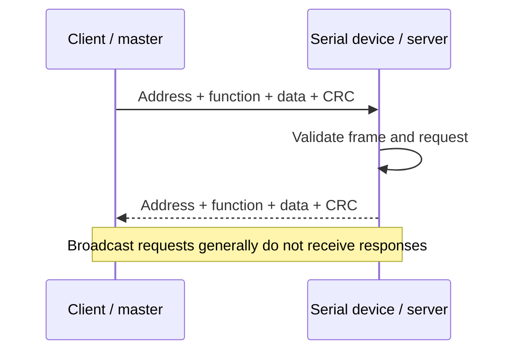

# RS485 & Modbus RTU Lab

An educational reference for serial communication used by some industrial instruments. Examples are conceptual and do not assert testing with physical devices.

## RS485 vs Modbus RTU
- **RS485** defines electrical signalling characteristics for a differential serial bus.
- **Modbus RTU** defines message framing and application-level function codes commonly carried over serial links.
- RS485 does not by itself mean a device supports Modbus; verify the device manual.

## Typical bus concept

Use a daisy-chain bus where recommended by the network design. Termination is generally applied at the two physical ends when required by cable, data rate, and equipment. Biasing should define the idle state; avoid duplicate bias networks without checking documentation. A/B labels are not perfectly consistent across vendors—confirm polarity from the specific manual.

## Modbus RTU request/response

A serial RTU frame includes a device address, function code, data, and CRC. Timing gaps help delimit frames. Responses depend on the requested function and device implementation.

## Configuration checklist
- Device address (unique on the bus)
- Baud rate, parity, and stop bits
- Supported function codes and register map
- Register address convention, data type, signedness, scaling, byte/word order
- Cable topology, pair polarity, termination and biasing
- Timeout and retry settings

## Example interpretation (illustrative only)
A hypothetical register containing integer `234` with documented scale `0.1 °C` would represent `23.4 °C`. Never assume a scale or register meaning without the device's register map.

## Troubleshooting
| Symptom | Checks |
|---|---|
| No response | Supply, wiring polarity, address, serial settings, supported function |
| CRC errors | Noise, cable routing, grounding, baud rate, termination, frame timing |
| Wrong value | Register offset convention, scaling, signedness, byte order, units |
| Sporadic failures | Topology, duplicate addresses, bus loading, bias/termination design |

## References
- [Modbus specifications](https://www.modbus.org/specs.php)
- [Modbus Organization FAQ](https://www.modbus.org/faq)

**Safety:** Follow equipment instructions and site procedures. **Status:** Learning/reference lab; no hardware test is claimed.